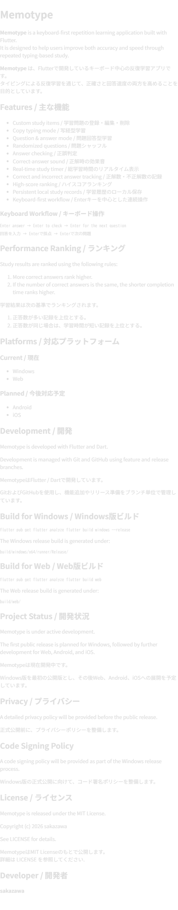

Memotype

Screenshot / スクリーンショット
Memotype screenshot

Memotype is a keyboard-first repetition learning application built with Flutter.
It is designed to help users improve both accuracy and speed through repeated typing-based study.

Memotype は、Flutterで開発しているキーボード中心の反復学習アプリです。
タイピングによる反復学習を通じて、正確さと回答速度の両方を高めることを目的としています。

Features / 主な機能
Custom study items / 学習問題の登録・編集・削除
Copy typing mode / 写経型学習
Question & answer mode / 問題回答型学習
Randomized questions / 問題シャッフル
Answer checking / 正誤判定
Correct-answer sound / 正解時の効果音
Real-time study timer / 総学習時間のリアルタイム表示
Correct and incorrect answer tracking / 正解数・不正解数の記録
High-score ranking / ハイスコアランキング
Persistent local study records / 学習履歴のローカル保存
Keyboard-first workflow / Enterキーを中心とした連続操作
Keyboard Workflow / キーボード操作
Enter answer
→ Enter to check
→ Enter for the next question
回答を入力
→ Enterで採点
→ Enterで次の問題
Performance Ranking / ランキング
Study results are ranked using the following rules:

More correct answers rank higher.
If the number of correct answers is the same, the shorter completion time ranks higher.
学習結果は次の基準でランキングされます。

正答数が多い記録を上位とする。
正答数が同じ場合は、学習時間が短い記録を上位とする。
Platforms / 対応プラットフォーム
Current / 現在
Windows
Web
Planned / 今後対応予定
Android
iOS
Development / 開発
Memotype is developed with Flutter and Dart.

Development is managed with Git and GitHub using feature and release branches.

MemotypeはFlutter / Dartで開発しています。

GitおよびGitHubを使用し、機能追加やリリース準備をブランチ単位で管理しています。

Build for Windows / Windows版ビルド
flutter pub get
flutter analyze
flutter build windows --release
The Windows release build is generated under:

build/windows/x64/runner/Release/
Build for Web / Web版ビルド
flutter pub get
flutter analyze
flutter build web
The Web release build is generated under:

build/web/
Project Status / 開発状況
Memotype is under active development.

The first public release is planned for Windows, followed by further development for Web, Android, and iOS.

Memotypeは現在開発中です。

Windows版を最初の公開版とし、その後Web、Android、iOSへの展開を予定しています。

Privacy / プライバシー
See PRIVACY.md for the Memotype Privacy Policy.

Memotypeのプライバシーポリシーについては、PRIVACY.md を参照してください。

Code Signing Policy / コード署名ポリシー
See CODE_SIGNING.md for the Memotype Code Signing Policy.

Memotypeのコード署名ポリシーについては、CODE_SIGNING.md を参照してください。

License / ライセンス
Memotype is released under the MIT License.

Copyright (c) 2026 sakazawa

See LICENSE for details.

MemotypeはMIT Licenseのもとで公開します。
詳細は LICENSE を参照してください.

Developer / 開発者
sakazawa